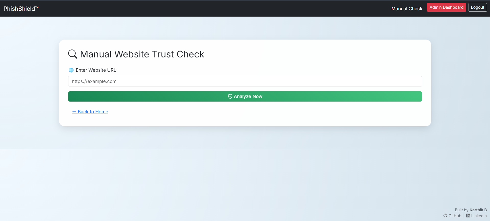
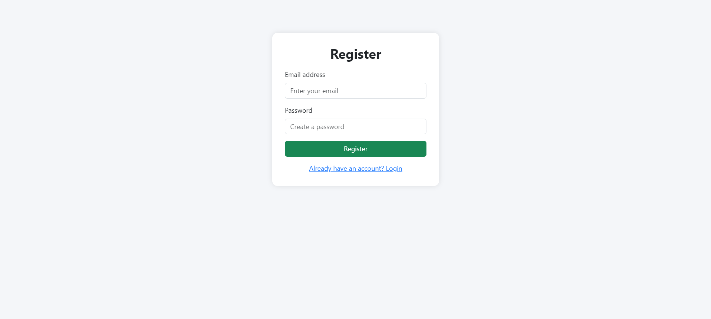
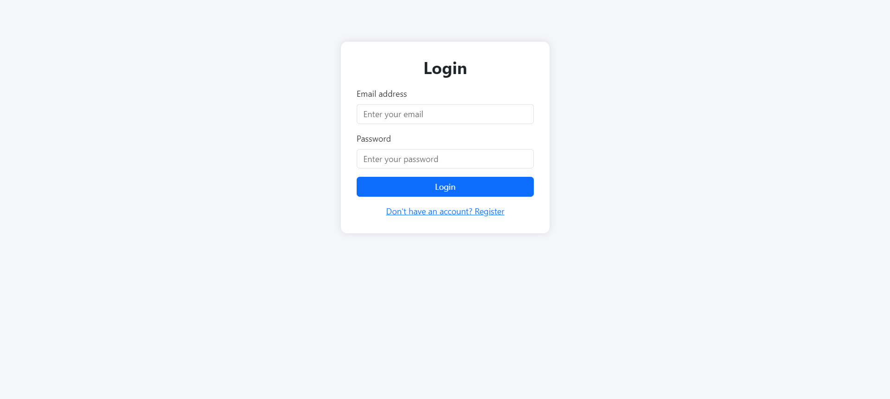
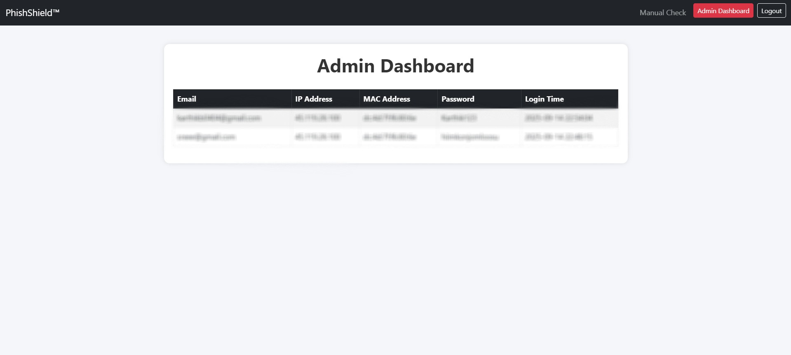
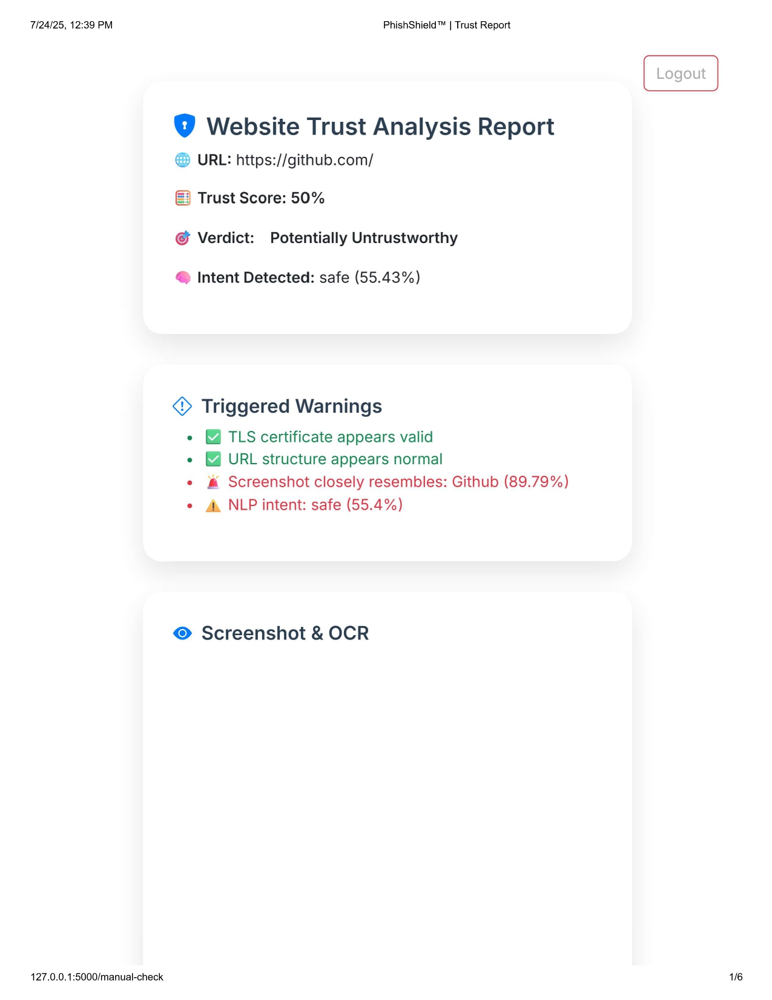
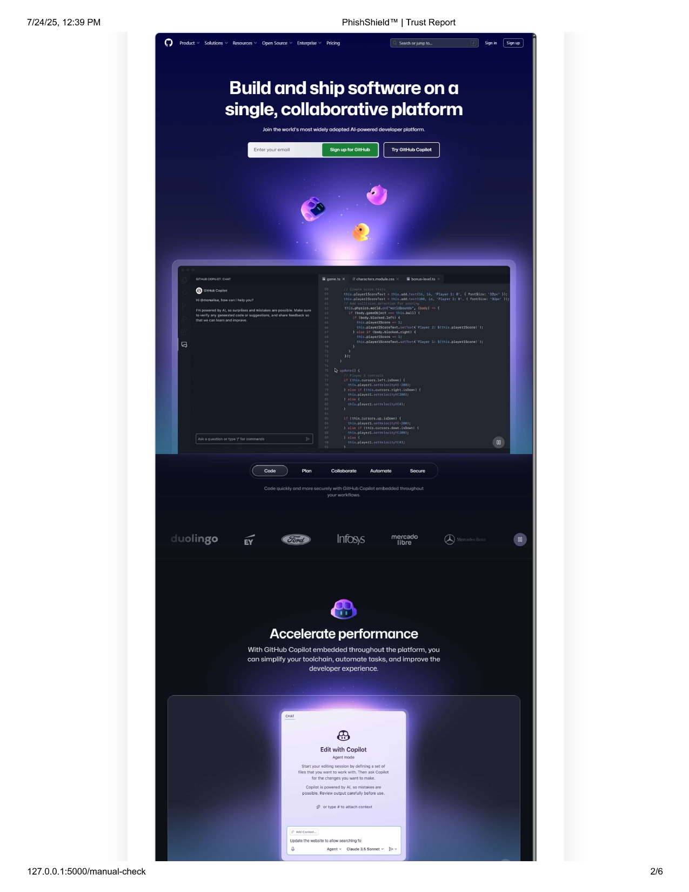

# PhishShield™ – Multi-Heuristic Phishing Detection System

[](LICENSE)


A Flask web application that scores how trustworthy a website is by running **seven independent detectors** (TLS, WHOIS, URL structure, JavaScript, DOM, visual similarity, and NLP intent over OCR text) and combining them into a single **trust score** and verdict: `Legit`, `Potentially Untrustworthy`, or `Not Trustworthy`.

> This repository documents the project (description, design, screenshots). The source code lives in a private repository, `advanced_phishing_detection-code`.

## Screenshots

| Home | Register | Login |
|---|---|---|
|  |  |  |

**Admin dashboard** (details blurred): shows who signed in, from which IP/MAC address, and when.



**Trust Analysis Report** for `https://github.com/` (generated by the app, exported as a PDF):

| Summary and warnings | Captured page screenshot |
|---|---|
|  |  |

## Why it exists
Blacklists and signatures lag behind new phishing sites. Combining many weak signals (certificate, domain age, how the page looks, what it says) catches sites that no list knows about yet.

## How it works

```
 URL
  |-- whitelist check (google, facebook, microsoft, amazon, apple) -> instant "Legit"
  |
  |-- TLS checker ........... expiry, issuer, SAN match         weight 20
  |-- WHOIS analyser ........ domain age, registrar             weight 15
  |-- URL analysis .......... keywords, length, depth, entropy  weight 10
  |-- JS analyser ........... suspicious script patterns        weight 25
  |-- DOM checker ........... forms, hidden inputs, iframes     weight 10
  |-- Visual check (CLIP) ... page screenshot vs brand refs    weight 10
  |-- NLP intent (BERT) ..... OCR text from screenshot         weight 10
  v
 trust score (0-100) -> verdict
```

1. **Scoring**: a detector adds its full weight only when it returns no flags at all; anything it reports is listed under "Triggered Warnings". Weights total 100.
2. **Verdict**: score >= 70 is **Legit**; 45 to 69 is **Potentially Untrustworthy**; below 45 is **Not Trustworthy**.
3. **Visual check**: a headless browser takes a full-page screenshot, a CLIP model embeds it, and the embedding is compared with reference screenshots of well-known login/home pages. A match of 75% or more raises a flag.
4. **Text intent**: Tesseract OCR reads the screenshot text; a small transformer classifies the intent as safe or phishing, and the score counts only when it says safe with confidence of at least 0.6.
5. **Random Forest model** (`ml_predictor`, trained by `to_train_model.py`) is available as an additional learned classifier over the detector outputs.
6. **Accounts**: Firebase Authentication handles register/login; each login is recorded (time, IP, MAC) for the admin dashboard.

### Reading the sample report
For `https://github.com/` the TLS and URL checks report good news (a green "certificate appears valid" and "URL structure appears normal"), the visual detector reports a screenshot "closely resembling Github (89.79%)", and the NLP intent is only 55.4% confident, below the 0.6 needed. The weights that count are WHOIS (15) + JS (25) + DOM (10) = **50**, so the verdict is *Potentially Untrustworthy*. Note that informational "valid" messages are stored with the same flag list as warnings, so a check that prints a green tick does not add its weight; scores for genuine sites therefore come out conservative.

## Pages and API
| Route | Purpose |
|---|---|
| `/login`, `/register`, `/logout` | Firebase-backed accounts |
| `/manual-check` | Paste a URL, get the Trust Analysis Report |
| `/admin` | Admin-only table of sign-in activity |
| `POST /api/check` | JSON endpoint returning the same analysis |

## Tech stack
Python, Flask, Firebase Authentication (pyrebase), scikit-learn, PyTorch + Transformers (CLIP, BERT), Selenium, Tesseract OCR, python-whois, BeautifulSoup, cryptography/ssl.

## Author
Karthik B. Licensed under GPL-3.0.
